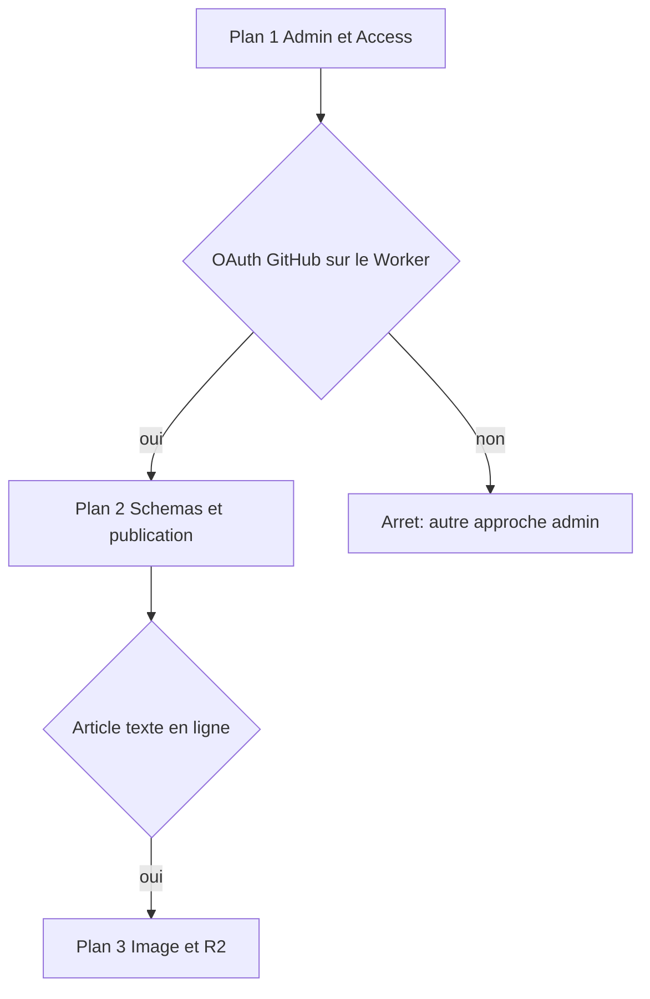

# Phase 1 — CMS en trois plans

I'm using the writing-plans skill to turn the reviewed spec into implementation plans. Phase 1 is not one plan. Each plan below ships something that can be checked on its own. Plan 2 starts only after plan 1's gate passes. Plan 3 starts only after a text article saved in the admin is actually live on `darkness.chenin.fr`.

## Revue du cadrage face au code

The spec at [docs/superpowers/specs/2026-10-10-admin-contenu-r2-design.md](docs/superpowers/specs/2026-10-10-admin-contenu-r2-design.md) matches the current site on the points that matter:

- Public site: Astro 5 (`astro` `^5.18.2` in [package.json](package.json); the spec says 5.17), Cloudflare adapter, `imageService: 'compile'` in [astro.config.ts](astro.config.ts), Worker `darkness-litt` on `darkness.chenin.fr/*`, zone `chenin.fr`, `nodejs_compat` in [wrangler.jsonc](wrangler.jsonc).
- Content is the submodule `src/content` → `jfchenin/darkness.litt-content` ([.gitmodules](.gitmodules)). Counts on this checkout: Darkness 20, Émile Moselly 9, four prose pages, `_templates` outside the collections.
- One literary schema in [src/content.config.ts](src/content.config.ts), one reader in [src/utils/posts.ts](src/utils/posts.ts). `showAuthor` is true only on [src/pages/[...lang]/darkness/[slug].astro](src/pages/[...lang]/darkness/[slug].astro). Public slug is `abbrlink`, otherwise the filename. Production hides `draft: true`; dev shows it.
- `pnpm build` updates the submodule, runs `astro check`, `astro build`, then LQIP. It does not deploy. `pnpm deploy` is that build plus `wrangler deploy`.
- Push to `main` of the content repo runs [src/content/.github/workflows/notify-main.yml](src/content/.github/workflows/notify-main.yml), which dispatches `content-updated`. [`.github/workflows/update-content.yml`](.github/workflows/update-content.yml) moves the submodule pointer and pushes `master`. It does not build. The Worker publish is the Cloudflare Git integration, which is not in the repo.
- Images in articles are ``. [src/plugins/rehype-image-processor.mjs](src/plugins/rehype-image-processor.mjs) turns `landscape `, `portrait `, and a leading `_` into figure / orientation / hidden caption. Zoom is global in [src/components/Widgets/ImageZoom.astro](src/components/Widgets/ImageZoom.astro). LQIP only appends `--lqip` on `img` in `dist/**/*.html`.

Nothing from the admin exists in code: no Keystatic, no R2 binding, no `admin.` route.

Corrections the plans must follow:

- Stay on Astro 5 in both apps. Keystatic on Astro 6 crashes because `Astro.locals.runtime.env` was removed ([Thinkmill/keystatic#1554](https://github.com/Thinkmill/keystatic/issues/1554)). That crash does not apply to Astro 5. GitHub OAuth on Workers is still a known failure ([Thinkmill/keystatic#1497](https://github.com/Thinkmill/keystatic/issues/1497), missing `redirect_uri` on token exchange). Plan 1 is the stop gate from section 8 of the spec.
- Cloudflare Access (email) is the gate in front of the hostname. Keystatic GitHub mode still asks the editor to sign in with GitHub and to have write access on `darkness.litt-content`. Access does not replace that login.
- The content branch written by the admin is `main`. The site branch pushed by `update-content.yml` is `master`. Those names stay as they are.
- [src/content/about/A propos.md](src/content/about/A propos.md) has post frontmatter (`title`, `published`, `abbrlink`, …). The `about` schema only accepts `lang`. The public page [src/components/ProsePage.astro](src/components/ProsePage.astro) renders `lang` and the body. The first save of that page from the admin rewrites the frontmatter down to `lang`. The body stays.
- [src/pages/og/[...image].ts](src/pages/og/[...image].ts) loads collections with no draft filter. A draft would still get `/og/<slug>.png`. Plan 2 aligns it with the public draft rule, because drafts become a real editing state.
- [src/content/.github/workflows/notify-main.yml](src/content/.github/workflows/notify-main.yml) pastes `github.event.head_commit.message` inside a JSON string. A quote or a newline in a Keystatic commit message breaks the dispatch. Plan 2 sends that message as a structured payload. The site workflow already reads it from the environment.
- The summary step of `update-content.yml` still says Cloudflare Pages. The site is a Worker. Plan 2 corrects that sentence.
- [src/utils/feed.ts](src/utils/feed.ts) renders with MarkdownIt and rewrites `./_images/`. It also builds Émile Moselly links with the collection id `emileMoselly` instead of `emile-moselly` from [src/i18n/path.ts](src/i18n/path.ts) (`getPostPath`). Plan 3 replaces that renderer so the new image tag is visible in the feed, and uses `getPostPath` for the item link.
- [scripts/new-post.ts](scripts/new-post.ts) still writes `src/content/posts/`, which is not a collection. These three plans leave that script alone.

## Découpage



- Plan 1 — Worker `admin.chenin.fr`, Cloudflare Access, Keystatic GitHub mode. No content model yet, no R2.
- Plan 2 — The existing collections in that admin, save Markdoc-edited `.md` files to `main` of the content repo, and update the public site through the chain already in place. Existing `./_images/` paths must still render after an edit; byte-identical source is not required.
- Plan 3 — R2, `media.darkness.chenin.fr`, upload of new JPEG, `` rendered with Sharp on new Markdoc articles. Existing `.md` articles and `./_images/` stay.

Later, outside these plans: migration of the 234 JPEG and the 229 markdown images, removal of `_images` from the content HEAD, Markdoc as the only body format, media deletion, a publish button, build progress in the admin.

## Contraintes communes

- Admin code lives in this repo, in a separate Astro app `admin/` with its own `package.json`, lockfile, and [admin/wrangler.jsonc](admin/wrangler.jsonc). It is not a route of the public Worker. Root `pnpm build` stays the public build.
- Admin Worker: name `darkness-litt-admin`, `compatibility_date` `2026-10-21`, flags `nodejs_compat`, `observability.enabled` and `observability.traces.enabled`, route `admin.chenin.fr/*`, zone `chenin.fr`.
- Astro 5 and `@astrojs/cloudflare` in `admin/`, same major as the public site. No Astro 6 or 7.
- Keystatic storage in production: `kind: 'github'`, repo `jfchenin/darkness.litt-content`. Local `astro dev` uses `kind: 'local'` against `admin/fixtures/`, so dev never writes the submodule.
- Secrets (`KEYSTATIC_GITHUB_CLIENT_ID`, `KEYSTATIC_GITHUB_CLIENT_SECRET`, `KEYSTATIC_SECRET`, `PUBLIC_KEYSTATIC_GITHUB_APP_SLUG`) are Wrangler secrets. They are listed in `admin/.env.example` and are not committed.
- The GitHub App is installed on `darkness.litt-content` only. `MAIN_REPO_PAT` used by the two workflows stays as it is. The admin never calls the site repo.
- One editor. Save commits on `main`. There is no pull request, no **Publier** button, no `workflow_dispatch` from the admin.
- New filenames and `abbrlink` match `^[a-z0-9-]*$`. Existing filenames and `abbrlink` values are not renamed.
- Literary fields stay those already read by the site: `title`, `author`, `published`, `description`, `updated`, `tags`, `draft`, `pin` (0–99), `toc`, `lang` (`''` or `fr`), `abbrlink`. Author remains a field on both collections; the public site still shows it only for Darkness.
- Prose singletons, paths preserved: `about/A propos.md`, `blogroll/blogroll-fr.md`, `legalNotices/fr.md`, `privacyPolicy/fr.md`. Field: `lang` plus body. `_templates` is not a collection.
- `draft: true` is stored, built, and omitted from public lists, post routes, and `/og/`. Default for a new admin entry is `draft: false`, matching [src/content.config.ts](src/content.config.ts). The draft field is visible.
- Image contract, unchanged from the spec: `src` is the R2 key `darkness/fichier.jpg` or `emileMoselly/fichier.jpg`, `alt` is the caption, `orientation` is `none | landscape | portrait`, `hideCaption` hides the caption. The visitor receives the Sharp output, not the R2 URL.
- Upload accepts JPEG only, at most 20 × 1024 × 1024 bytes, and refuses a key that already exists. No delete API.
- Owner actions outside the repo, before plan 1 can be deployed: Cloudflare account for zone `chenin.fr`, DNS `admin.chenin.fr`, the email allowed in Access, and permission to create the GitHub App. Plan 2 also needs the Git integration build command. Plan 3 needs DNS `media.darkness.chenin.fr` and permission to create an R2 bucket.

## Plan 1 — Admin séparé et Access

**Goal:** `https://admin.chenin.fr/keystatic` loads for the allowed email, and GitHub OAuth completes on the Worker. An anonymous request is refused by Access.

**Files:**

- Create: `admin/package.json`, `admin/astro.config.ts`, `admin/wrangler.jsonc`, `admin/keystatic.config.ts`, `admin/src/pages/index.astro`, `admin/.env.example`, `admin/README.md`
- Modify: none in the public app

**Tasks:**

1. Scaffold `admin/` as an Astro 5 app with `@astrojs/cloudflare` (`imageService` irrelevant here), `@keystatic/astro`, `@keystatic/core`, React. `keystatic.config.ts` has `storage.kind: 'github'` and repo `jfchenin/darkness.litt-content` when `KEYSTATIC_STORAGE=github`, and `storage.kind: 'local'` with `local.projectRoot: 'admin/fixtures'` otherwise. Collections are empty for this plan. `astro.config.ts` registers `keystatic()`. `vite.optimizeDeps.include` contains `react`, `react-dom`, `react/jsx-runtime` so the Worker bundle does not ship raw CJS React.
2. `admin/wrangler.jsonc` as in the constraints. `main` is the Astro Cloudflare output (`dist/_worker.js/index.js`), assets directory `./dist`. Do not add this route to the public [wrangler.jsonc](wrangler.jsonc).
3. `admin/src/pages/index.astro` is a short banner: open `/keystatic`, stay on branch `main`, **Enregistrer** writes the content repo. No second editorial UI.
4. Deploy the Worker and attach the route. Create the GitHub App with callback `https://admin.chenin.fr/api/keystatic/github/oauth/callback` and install it on `darkness.litt-content` only. Put the four secrets on the Worker.
5. Cloudflare Access application on `admin.chenin.fr`, policy allow the owner email, browser session. The OAuth callback stays on that hostname so the Access cookie is sent on the return from GitHub.

**Gate:** from a private window, `GET /keystatic` returns the Access login, not the Keystatic UI. After email and GitHub login, `/keystatic` renders and `/api/keystatic/*` does not return 401.

**If the callback returns 401:** one retry, a `pnpm.patchedDependencies` patch in `admin/` that sends the same `redirect_uri` on the GitHub token exchange as on the authorize redirect. Re-deploy and retry once. If it still fails, stop. Plans 2 and 3 are not started. Do not upgrade Astro to get past this.

**Done when:** the README lists the deploy command (`pnpm --dir admin run deploy`), the secret names, the Access policy, and the callback URL. No content commit is required in this plan.

## Plan 2 — Modèle de contenu et publication

**Goal:** the owner creates and edits a text article in the admin, saves, and the public site shows it through the current chain. A draft save stays off the public site. After a title-only edit of an existing article, its `./_images/` images still render.

**Files:**

- Create: `shared/literary-fields.ts`, `shared/literary-fields.test.ts`
- Modify: [src/content.config.ts](src/content.config.ts), [src/pages/og/[...image].ts](src/pages/og/[...image].ts), [package.json](package.json) `test` script, [`.github/workflows/update-content.yml`](.github/workflows/update-content.yml), [src/content/.github/workflows/notify-main.yml](src/content/.github/workflows/notify-main.yml) (content repo), `admin/keystatic.config.ts`, `admin/README.md`

**Contract** in `shared/literary-fields.ts`, imported by the public schema and by Keystatic:

```ts
export const literaryFieldNames = [
  'title', 'author', 'published', 'description', 'updated',
  'tags', 'draft', 'pin', 'toc', 'lang', 'abbrlink',
] as const
export const abbrlinkPattern = /^[a-z0-9-]*$/
export const defaultAuthor = 'JFChenin'
export const proseEntries = [
  { collection: 'about', path: 'about/A propos' },
  { collection: 'blogroll', path: 'blogroll/blogroll-fr' },
  { collection: 'legalNotices', path: 'legalNotices/fr' },
  { collection: 'privacyPolicy', path: 'privacyPolicy/fr' },
] as const
```

Public zod keeps today's defaults (`draft` false, `pin` 0–99, `toc` true, `lang` `'' | 'fr'`, empty or null `updated` becomes `undefined`). The test asserts `literaryFieldNames` and `abbrlinkPattern`. Add that file to the `pnpm test` list.

**Tasks:**

1. Dashboard check, before any save that should publish: the Cloudflare Git integration build command for this Worker is `pnpm build`. If it still runs `pnpm deploy` or expects `wrangler` inside `build`, change the platform command to `pnpm build`. Do not put `wrangler deploy` back into the npm `build` script.
2. Keystatic collections `darkness` (`darkness/*`) and `emileMoselly` (`emileMoselly/*`). Frontmatter fields come from the shared contract. Body is `fields.markdoc({ label: 'Corps', extension: 'md' })` with `format: { contentField: 'content' }`. The entry slug is the filename; the UI says the public URL is `abbrlink` when set, otherwise that filename. Singletons use `proseEntries` paths and a `lang` field plus the same Markdoc `.md` body. No `_templates` path. No image upload field.
3. Replace the `client-payload` string interpolation in `notify-main.yml` with `actions/github-script` calling `repos.createDispatchEvent`. `client_payload.commit_message` is `context.payload.head_commit.message`. Same event type `content-updated`, same repository `jfchenin/darkness.litt`, same `MAIN_REPO_PAT`. Commit this on `main` of the content repo with git once, before Keystatic saves depend on it.
4. In `update-content.yml`, the summary says the Worker is published by the Git integration running `pnpm build`.
5. In `src/pages/og/[...image].ts`, skip entries with `data.draft` when building `pages`, same rule as production lists.

**Tests:**

- `pnpm test` covers `shared/literary-fields.test.ts`.
- Manual, in order: save a new Darkness article `draft: true` with abbrlink `phase1-brouillon`. Confirm the commit on content `main`, then `notify-main.yml`, then `update-content.yml` pushing `master`, then a Worker build whose command is `pnpm build`. After deploy, `/darkness/phase1-brouillon/` is absent and so is `/og/phase1-brouillon.png`. Set `draft: false`, save again, the page and the OG image respond. Edit one existing article's title only, save, and confirm every image using a `./_images/` path still renders; source rewriting is acceptable. Open À propos, save, confirm the body text is still on `/about/` after the frontmatter rewrite.

**Done when:** that checklist passes. The test article can then be deleted in Keystatic (text delete is allowed; this plan still has no media delete).

## Plan 3 — Composant image pour les images nouvelles

**Goal:** a new article can include a JPEG stored on R2, inserted as the spec's image tag, and the public page shows the same figure as today (caption, orientation, zoom) with a Sharp URL. Existing `.md` files and their `./_images/` are not rewritten.

**Why two body formats:** Plan 2 edits existing `.md` articles with Keystatic's Markdoc field and accepts source rewriting when existing images still render. The custom image component exists on new `.mdoc` articles, where an Astro component can call `Image` from `astro:assets`. The tag bytes are the spec's tag:

```markdoc

```

**Files:**

- Create: `shared/article-image.ts`, `shared/article-image.test.ts`, `src/components/ArticleImage.astro`, `admin/src/lib/jpeg-upload.ts`, `admin/src/lib/jpeg-upload.test.ts`, `admin/src/pages/media/index.astro`, `admin/src/pages/api/media.ts`
- Modify: [astro.config.ts](astro.config.ts) (Markdoc, remote image host), [src/content.config.ts](src/content.config.ts) globs, [src/utils/feed.ts](src/utils/feed.ts), [scripts/apply-lqip.ts](scripts/apply-lqip.ts), `admin/keystatic.config.ts`, `admin/wrangler.jsonc`, [package.json](package.json) test script

**Contract** in `shared/article-image.ts`:

```ts
export type ImageOrientation = 'none' | 'landscape' | 'portrait'
export interface ArticleImageProps {
  src: string
  alt: string
  orientation: ImageOrientation
  hideCaption: boolean
}
export function parseArticleImageKey(src: string):
  | { collection: 'darkness' | 'emileMoselly', file: string }
  | null
```

`parseArticleImageKey` accepts `darkness/<nom>.jpg` and `emileMoselly/<nom>.jpg` where `<nom>` is `[a-z0-9-]+`. It rejects `..`, extra slashes, other collections, and other extensions. Tests cover those cases. `ArticleImage.astro` renders `<figure>` with `data-orientation` only when orientation is `landscape` or `portrait`, an `Image` whose `src` is `https://media.darkness.chenin.fr/<key>`, `alt` always set, and `figcaption` only when `hideCaption` is false and `alt` is non-empty. `astro.config.ts` allows that host via `image.remotePatterns`. A missing object fails `astro build`.

**Upload:** R2 bucket `darkness-litt-media`, public read on `media.darkness.chenin.fr`, directory listing off. Binding `MEDIA` on the admin Worker only. `POST /api/media` checks JPEG magic bytes `FF D8 FF`, size ≤ 20 MiB, key shape from `parseArticleImageKey`, and `head(key)` empty. Collision returns 409 and writes nothing. `GET /api/media` lists keys through the binding. The page `/media` uploads, then a form (key, alt, orientation, hide caption) shows the tag to copy into the new article. The public Worker has no R2 binding.

**Keystatic:** add collections `darknessMarkdoc` (`darkness/*.mdoc`) and `emileMosellyMarkdoc` (`emileMoselly/*.mdoc`) using the same frontmatter contract. Body is `fields.document` with one component block `image` whose fields are `src`, `alt`, `orientation`, `hideCaption`. `src` is a text field, not a Keystatic file upload, so the save does not commit a binary. The plan 2 `.md` collections keep their Markdoc `.md` fields. Public globs become `**/*.{md,mdoc}`.

**Feed:** [src/utils/feed.ts](src/utils/feed.ts) stops using MarkdownIt and the `/src/content/{darkness,emileMoselly}/_images/**` glob. For each of the latest 25 non-draft posts, render with `astro:content` `render` and `experimental_AstroContainer.renderToString`, then sanitize. Allow `img`, `figure`, `figcaption`. Item `link` comes from `getPostPath(slug, lang, collection)`. Old `./_images/` still resolve because `.md` still uses the current remark/rehype pipeline. New tags resolve because `.mdoc` runs `ArticleImage`.

**LQIP:** export the HTML rewrite from [scripts/apply-lqip.ts](scripts/apply-lqip.ts) and run it only when the file is the CLI entry. A node test feeds a `<figure data-orientation="portrait"><figcaption>Légende</figcaption></figure>` plus a map for that src, and asserts the figure, the caption, and `data-orientation` remain, with `--lqip:#…` added on the `img`.

**Checklist:** upload a JPEG under 20 MiB and receive a key. A non-JPEG, a file over 20 MiB, and the same key a second time are refused, and the bucket is unchanged. Create a new `.mdoc` Darkness article that pastes the tag, `draft: false`, save. After the Worker deploy, the page shows the figure, the caption, the orientation, and an `img` whose `src` is the built asset. The page source does not point the visitor at `media.darkness.chenin.fr` for that image. Zoom still opens on click. The RSS item contains that optimized URL and contains no `./_images/`. An existing `.md` article still shows its current `./_images/` figures. `pnpm test` runs the new pure tests.

## Hors de ces trois plans

Migration of the 234 JPEG (~557 Mo), rewrite of the 229 markdown images, deletion of `_images` from the content HEAD, git history purge, deleting media from the admin, build status in the admin, a distinct publish button, preview environment, Astro 7, AVIF/WebP/PNG, and Markdoc ports of `:::note`, GitHub cards, KaTeX, Mermaid, and embeds. `scripts/new-post.ts` stays as it is.
